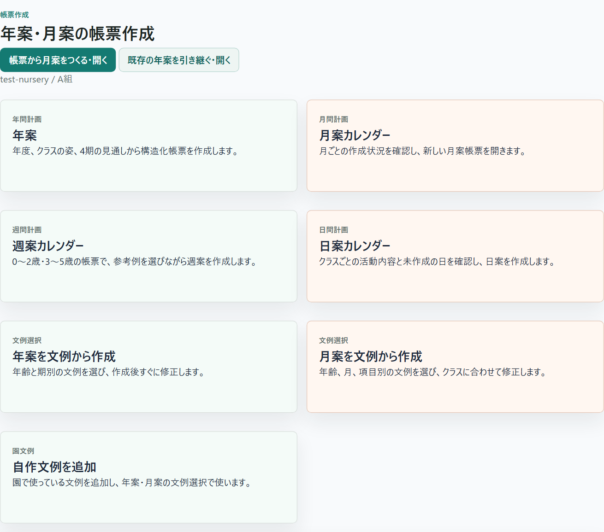
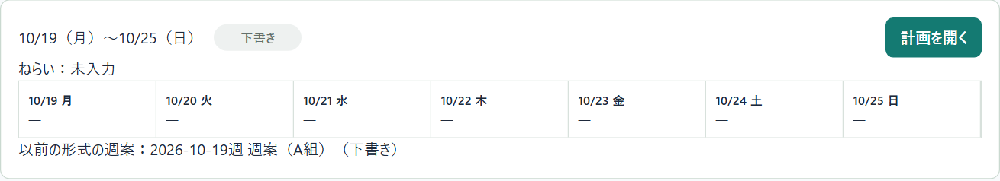

# 一般職員が「指導計画」を開いたときの入口

2026年11月8日の現状確認と整理案。職員ホームの「よく使う機能」と左メニューの「指導計画」は、どちらも同じトップを開く。実機の稼働版 `d9074c1` を照合し、その版を使って、架空の担当クラスを持つ一般職員の画面で確認した。[方針の記録 SD-033](spec-decisions.md#sd-033)

### 11月8日追記　自園で先に試す入口

自園の年案・月案・週案・日案の書き方を一般職員向けに4ページにまとめた。確認用の「指導計画」から「自園の年案・月案・週案・日案の書き方を見る」で開ける。[作成範囲・保存の検証 SD-038](spec-decisions.md#sd-038)

帳票検索を反映した後の、一般職員向けの確認原稿を作成した。指導計画トップ（ローカル資料: `tools/staff-manual-preview/reviews/staff-home/plans.html`）・帳票一覧（ローカル資料: `tools/staff-manual-preview/reviews/staff-home/plan-search.html`）・旧式の帳票（ローカル資料: `tools/staff-manual-preview/reviews/staff-home/plan-legacy.html`）。撮影の基準と範囲は[SD-037](spec-decisions.md#sd-037)を参照。

07:17 JSTに光の原保育園の職員用アプリに反映した。以下の月日・クラス名は確認用モックの例。[実機で確認できた範囲](deployment-plan-navigation-2026-11-08.md)

保存した帳票が増えたときに「帳票一覧」で目的の文書を見つけるため、[帳票検索の確認版（SD-036）](spec-decisions.md#sd-036)を別途用意した。園児名で探す場面と、クラス・状態・様式などを絞る場面を試せる。その後、モックの確認を経て[光の原保育園の実機に反映](deployment-document-search-2026-11-08.md)した。

自園の帳票を標準にし、旧式も独立した入口から使える方針で合意した。以下の現状確認は変更前の記録。今回の確認版は「自園の帳票」の年案・月案・週案・日案を最初に並べ、その下の「旧式の帳票」で以前に書いた帳票を開いたり、旧式の年案や月案を書き始めたりできる。[合意と試用範囲 SD-034](spec-decisions.md#sd-034)

架空のさくら組で次の操作を試せる。

1. 指導計画トップで「年案」を選び、2026年度の自園様式を開く。「旧式の帳票」からは手入力と文例の入口を選べる。
2. 「月案」の2026年度・0歳児で10月を開く。旧式だけが保存されている。11月には両方があり、それぞれの帳票を開ける。
3. 「週案」の2026年11月・0歳児で11月2日の週と9日の週を見比べる。2日の週は旧式のみ。9日の週は自園と旧式の両方の続きを開ける。
4. 画面上部の「場面を切り替える」から、空の一覧、入力済み、読込エラーからの再読込も試せる。場面ごとの変更はモック起動中だけ保持する。園ごとの様式設定は今後の検証対象。

## 今はどこを押すと、何ができるか

いちばん違いが見えやすいのは年案。上段の「既存の年案を引き継ぐ・開く」は園の年間指導計画の様式を開く。すぐ下の大きな「年案」は、クラスの姿や4期の見通しを入力して別形式の文書を作る。「年案を文例から作成」も従来形式の文書を作る。職員は、同じ年案を書き始めるつもりでも、最初に押す場所で保存先の文書が変わる。ここでいう形式の違いは、同じアプリの文書にどの項目・様式が保存されるかを指す。

| 計画 | マニュアルで先に案内したい現行の入口 | 併存する操作・画面 |
| --- | --- | --- |
| 年案 | **既存の年案を引き継ぐ・開く**。年度とクラスを選び、登録済みの原本や前年の年案を基に編集。対象の保存済み帳票があれば開く。 | 「年案」「年案を文例から作成」は従来形式の新規作成。原本・前年の帳票がそろわない場合に園がどう運用するかは確認が必要。 |
| 月案 | **月案カレンダー**でクラス・年齢・月を選ぶ。「帳票から月案をつくる・開く」は同じ帳票への近道。文例の検索もこの帳票内でできる。 | 「月案を文例から作成」は従来形式の別文書を作成。従来の手入力フォームも残る。旧月案は「最近の帳票」→「すべて見る」から探せる。 |
| 週案 | **週案カレンダー**で該当する週を開く。0～2歳は週ごとの計画、3～5歳は曜日ごとの活動を記入する。 | 以前の形式の週案は、該当する週のカード下部から開ける。同じカード上部のボタンは新帳票を開く。 |
| 日案 | **日案カレンダー**で日付とクラスを選ぶ。作成済みなら文書詳細、未作成なら入力画面へ進む。 | 入力画面の「この候補を下書きへコピー」は、開いている日案の入力を助ける機能。年案・月案の「文例から作成」とは行き先が異なる。 |

保存済みの文書は共通の「帳票一覧」から詳細を開ける。「修正」は、その文書の形式と編集できる状態に応じた画面へ進む。旧文書の本文、レビュー結果、改訂履歴、既存の通知からのリンクは、トップを整理した後も同じ文書につなぐ案とする。[年案の原本と対象クラス](deployment-annual-r8-all-classes-2026-09-29.md)／[月案・週案カレンダーの配備記録](deployment-weekly-calendars-2026-10-11.md)／[日案の文例選択](deployment-daily-example-list-2026-10-11.md)

## カレンダーで間違えやすい場面

- **月案があるのに「未作成」と出る。** 架空のクラスに10月の旧月案だけを保存した。帳票一覧からは本文を開いて修正できたが、月案カレンダーの10月は「未作成」「＋ 作成」と表示された。カレンダーは新帳票だけを数えている。改善案は「新しい帳票は未作成」と範囲を明示し、同じクラス・月の旧月案も別リンクで開けるようにすること。旧月案に年齢の情報がない場合は、クラス・月で見つけられるようにする。
- **週案の「下書き」を開いたつもりで空の帳票に入る。** 旧週案だけがある週で、カード上部は「下書き」「計画を開く」。押すと新帳票の状態は「未作成」だった。旧週案の本文はカード下部の別リンクから開けた。改善案は「以前の週案を開く」と「新しい帳票で作成」を分け、状態をそれぞれの文書の横に出すこと。
- **年案の対象が1歳だけに見える。** 旧年案の入力画面からのリンクには「既存の年案を引き継ぐ・開く（1歳児）」と残っている。光の原保育園では令和8年度の0～5歳の原本が配備済み。リンクは年齢を限定しない表記にそろえ、選んだクラスで利用できる原本を引継ぎ先に表示する案とする。

## トップとマニュアルの整理案

1. **「年案」「月案」「週案」「日案」を、新しく書くときの4つの入口にする。** 見出し案は「指導計画」。年案は園の様式へ、月案・週案・日案はカレンダーへつなぐ。月案の直接リンクは必要に応じて月案の欄に添える。
2. **続きを書く人は、保存済みの文書から再開できるようにする。** 「最近の帳票」と「すべて見る」を残し、年案・月案・週案で形式が混じるところに「園の様式」「以前の様式」の目印を付ける。承認・差戻しの通知、反省の未提出案内は、該当する文書を直接開く今の動作を保つ。
3. **以前の様式で新しく作る入口は、当面は補助に移す。** 手入力、年案・月案の「文例から作成」、「自作文例を追加」は用途が分かるようにまとめる。新しい月案の中で文例を探す手順、週案・日案に参考例をコピーする手順は各帳票のページに載せる。

**次に確認したいこと**は、引継ぎ元のない年度・クラスや園独自の文例を使う業務で、今後も旧形式の**新規作成**が必要かどうか。保存済みの旧文書を開く・続きを書く用途は別に扱う。実機の削除・アーカイブを除く形式別件数を読み取り専用で照合し、編集中に当たる状態の旧年案・旧月案が残っていることを確認した。件数から今後の新規作成需要までは判断できない。

マニュアルは入口の合意後、「指導計画トップ」→「年案」→「月案」→「週案」→「日案」の順でページごとに確かめる。本文のレビューと、年案・日案の反省の承認は操作が異なるため、該当ページで分けて案内する。月案の担当割当については[既存の確認事項 SD-001](spec-decisions.md#sd-001)を引き継ぐ。
